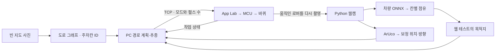

# ParkingHaeven 기술 발표 가이드

**“웹에서 P5를 선택하면 로버는 어떻게 그 칸까지 갈까?”** 빈 지도 사진에서 도로와 주차칸을 한 번 만들고, 주행 중에는 카메라로 빈칸과 로버 위치를 계속 갱신한다. PC가 다음 회전·전진을 결정하면 보드는 바퀴의 실제 회전을 세어 그 동작을 마친다. 아래 여덟 절은 이 흐름을 따라가는 발표 순서다.



## 1. 종이 지도에서 도로와 주차칸을 읽는다

| 단계 | 코드에서 하는 일 | 발표 화면에서 짚을 부분 |
| --- | --- | --- |
| 색 분리 | OpenCV로 BGR을 HSV로 변환한다. 빨강은 색상환 양 끝의 두 범위를 합친다. 초록은 일반칸, 파랑은 장애인칸, 어두운 영역은 건물·출입구 후보로 분리한다. | 사진 위에 빨간 도로만 남긴 마스크를 겹쳐 보여준다. |
| 도로 중심선 | 빨강 마스크의 가장 큰 연결 성분을 남기고 `skeletonize`로 선을 1픽셀 두께로 줄인다. | 두꺼운 펜 선이 한 줄로 줄어드는 모습을 보여준다. |
| 끝점·교차점 | 중심을 뺀 3×3 커널로 각 중심선 픽셀의 **8방향 이웃**을 센다. 이웃 1개는 끝점, 2개는 보통 선의 중간, 3개 이상은 교차점 후보다. 인접한 교차점 후보는 팽창 후 연결 성분의 중심 하나로 묶는다. | T자 가운데 여러 픽셀이 검출돼도 교차점 하나로 표시되는 이유다. |
| 도로 그래프 | 끝점과 교차점을 노드로, 그 사이 중심선을 간선으로 묶는다. NetworkX `MultiGraph`에 간선의 길이와 순서 있는 픽셀열 `path`를 함께 저장해 곡선과 평행 간선을 표현한다. | 노드 사이에 직선을 그었을 때 사라지는 도로 굴곡을 실제 `path`와 비교한다. |
| OCR과 공간 ID | RapidOCR로 A/B, EN/EX, P1~P6을 읽는다. 글자 상자 네 꼭짓점의 평균이 **이름표의 힌트 좌표**다. 색으로 찾은 영역의 경계 상자에 힌트가 들어가는지 확인해 ID를 붙이고 주차칸·출입구와 도로 끝점을 일대일로 연결한다. | 초록 영역이 여러 개여도 P5 글자가 들어 있는 영역을 `space_5`로 찾는다. |

OCR 힌트는 이름을 붙이는 데 쓴다. 주행 목적지 좌표는 선택한 **주차칸 다각형의 기하 중심**에서 따로 구한다. 필수 이름표 10개가 각각 한 번씩 인식되고 신뢰도 기준(기본 0.75)을 통과해야 지도를 게시한다. 저장소 기본 사진에서 그래프를 다시 생성한 결과는 **노드 14개, 간선 13개, 전체 연결**이었다. [기본 지도 사진](../assets/maps/parking_map_real.png) · [중심선·8이웃](../src/map_processing/graph_builder.py) · [그래프 생성](../src/map_processing/graph_exporter.py) · [OCR 판독](../scripts/ocr_buildings.py) · [힌트 생성](../scripts/generate_map.py) · [영역에 ID 연결](../src/map_processing/semantic_mapper.py)

## 2. 차량 검출 모델을 ONNX로 배포해 칸별 점유를 구한다

배포 파일은 차량 한 종류(`car`)를 검출하는 YOLOv8 모델 `parking_cars.onnx`다. 모델 내부 메타데이터에는 Ultralytics, 학습 데이터 설정 `parking_dataset_v2/data.yaml`, 검출 작업 `detect`, ONNX opset 12가 기록돼 있다. 최종 저장소에서 재현할 수 있는 단계는 **배포된 가중치 로드 → 추론 → 점유 판정**이다. 학습 원본·학습 명령·검증 mAP는 별도 자료가 필요한 항목이다. [모델 입출력 명세](../web/parkinghaeven/models/manifest.json) · [웹과 모델 배포 기록](../web/parkinghaeven/README.md)

1. Python은 OpenCV DNN으로 ONNX를 연다. 원본 비율을 유지해 영상을 축소·확대하고 남는 공간을 채워 640×640으로 만든다. RGB 순서, 0~1 값 범위의 입력 텐서는 `[1, 3, 640, 640]`이다.
2. 출력 `[1, 5, 8400]`은 8,400개 후보 각각의 중심 x·y, 폭·높이, 차량 점수다. 여백과 배율을 역산해 원본 픽셀로 복원하고, 겹친 후보는 NMS(겹침 임계값 0.45)로 줄인다. 실시간 감시는 차량 점수 **0.70 이상**을 사용한다.
3. 같은 프레임의 ArUco 네 모서리를 포함하고 크기·중심 조건까지 맞는 차량 박스가 정확히 하나면 제어 중인 로버로 보고 제외한다. 남은 차량의 **박스 중심**이 어느 칸의 다각형 안에 있는지 검사한다. 로버가 P5에 들어와도 자기 자신 때문에 목표 칸을 점유 처리하는 일을 줄인다.
4. 차량이 있으면 `occupied`, 추론에 실패하면 `unknown`을 반영한다. 빈칸은 새 관측 세 번 이상이 2초 이상에 걸쳐 확인돼야 `free`가 된다. 관측은 5초 후 만료된다. **0.70은 개별 박스 채택 기준**이며 모델 정확도를 측정한 수치는 별도로 필요하다. [모델 전후처리](../src/parking_detection/onnx_occupancy.py) · [실시간 점유·로버 제외](../scripts/server_camera.py) · [빈칸 확인·만료](../src/rover_control/live_parking.py)

## 3. 카메라를 여는 쪽을 브라우저에서 Python으로 옮겼다

| | 영상과 결과가 오가는 순서 | 설계 이유 |
| --- | --- | --- |
| 초기 브라우저 카메라 방식 | 웹캠 → 브라우저에서 프레임 JPEG 인코딩 → HTTP POST `/api/aruco` → Python 검출 → 응답. 차량 모델은 브라우저에서도 ONNX Runtime Web으로 실행했다. | 현장에서 마커 검출 자체가 약 19ms여도 응답 간격이 약 3초까지 벌어진 사례가 있었다. 촬영·인코딩·요청 대기·탭 실행 주기가 모두 최신 위치를 얻는 시간에 영향을 줬다. |
| 최종 Python 카메라 방식 | Python OpenCV가 웹캠을 한 번 열고 원본을 읽는다. 서버에서 ArUco와 차량을 분석하고 브라우저는 HTTP GET으로 미리보기 JPEG와 검출 결과를 가져간다. 지도 생성 시에는 같은 카메라의 원본 프레임을 PNG로 사용한다. | 웹을 최소화해도 촬영과 분석을 이어간다. ArUco 작업은 새 프레임 도착 알림을 받아 깨어나고, 표시용 JPEG를 받아야 분석을 시작하는 의존성이 사라졌다. |

HTTP는 두 방식 모두에 쓰인다. 달라진 것은 **카메라 소유권과 영상 전송 방향**이다. 최종 주행기는 PC의 HTTP 서버에서 위치·목적지·점유 JSON을 읽고, 보드와는 핫스팟을 통한 별도 TCP 연결을 사용한다. 최소화 중 수동 이동 시험에서 212개 프레임 모두 마커가 검출됐지만, 같은 기록의 위치 조회 597회 중 111회는 200ms 기한을 넘겼다. 검출 성공과 제어에 쓸 만큼 최근인 관측은 따로 측정했다. [기존 JPEG 업로드](../scripts/rover_aruco_bridge.js) · [Python 카메라 작업](../scripts/server_camera.py) · [HTTP 경로](../scripts/http_map_server.py) · [현장 측정 기록](PROJECT_HANDOFF.md)

## 4. 빨간 십자와 마커 높이로 픽셀을 실측 cm로 바꾼다

**바닥 보정.** 전지 왼쪽 위를 원점으로 두고 오른쪽이 +x, 아래가 +y가 되게 cm 좌표를 정한다. 빨간 십자의 오목한 꼭짓점 네 개로 만든 사각형의 대각선 교점을 십자 중심으로 잡는다. A~D의 영상 중심 네 점과 줄자로 잰 바닥 위치 네 점으로 3×3 호모그래피(평면 원근 변환)를 구한다. 기본 전지는 109.5×79cm다. 이 네 점과 독립적으로 **P5 진입로와 EN–EX 주도로가 만나는 교점**의 변환 결과를 실측 `(61, 39.5) cm`와 비교한다. 이 P5는 보정 확인점이며 실행 목적지는 매번 웹에서 고른다. [기준점 실측 파일](../assets/maps/parking_map_real_markers.json) · [빨간 십자 검출](../src/map_processing/floor_markers.py) · [독립 교점 검산](../src/rover_control/map_preview.py)

**높이 보정.** ArUco는 로버 지붕에 붙어 있다. 카메라에서 마커를 지나는 광선을 바닥까지 연장하면, 렌즈 바로 아래에서 멀어질수록 위치가 바깥으로 밀려 보인다. 바닥 호모그래피로 구한 점을 `Q`, 렌즈의 바닥 좌표를 `C=(x,y)`, 바닥에서 잰 렌즈 높이를 `H`, 마커 높이를 `h`라 하면 다음 식으로 마커 바로 아래의 위치를 구한다.

```text
보정 위치 = C + (1 − h/H) × (Q − C)
```

예를 들어 렌즈 높이 100cm, 마커 높이 10cm이고 바닥 투영점이 렌즈 수직 아래에서 오른쪽으로 40cm라면 보정 위치는 오른쪽 **36cm**다(설명용 수치). 코드에서는 마커의 중심과 전방점 모두를 변환한 뒤 두 점의 차로 월드 방향각을 구한다. 기본 마커는 `DICT_4X4_50`의 ID 7이며, 오른쪽이 0°, 시계 방향이 양수다. [ArUco 검출](../src/rover_control/aruco_tracker.py) · [월드 좌표·높이 보정 구현](../src/rover_control/pose_sender.py)

## 5. 차량 점유는 목적지를 바꾸고 다익스트라는 갈 길을 찾는다

**어느 칸으로 갈까?** 자동 선택은 요청 유형에 맞는 최신 `free` 칸만 후보로 둔다. 입구·출구 근처 조건은 도로를 따른 최단 거리, 건물 근처 조건은 주차 노드에서 건물 경계 상자까지의 거리를 점수로 사용한다. 예를 들어 자동 선택한 P5에 다른 차량이 들어오면, 자동 재선택이 켜져 있고 도착 목표가 확정되기 전인 경우 조건에 맞는 다른 빈칸을 찾아 목적지와 `route_revision`을 갱신한다. 대안이 없으면 안내를 막는다. 사용자가 **직접 P5를 지정**했으면 P5가 점유될 때 그 칸의 안내를 차단한다. [조건별 점수](../src/map_processing/parking_selector.py) · [실시간 후보 선택](../src/rover_control/live_parking.py) · [목적지 변경 조건](../src/rover_control/arrival_test.py)

**선택한 칸까지 어떻게 갈까?** 주행기는 현재 웹 테스트의 `parking_space_id`로 칸 중심을 찾는다. 새 ArUco 관측 한 장의 보정 위치와 목표 중심을 각각 가장 가까운 도로 선분에 투영한다. 도로를 cm로 변환해 구간 길이를 가중치로 부여하고 두 투영점을 임시 노드로 추가한다. **다익스트라**는 누적 거리가 짧은 후보부터 탐색해 두 점 사이의 연결 경로를 구한다. 이때 나란히 지나가는 도로는 그래프에서 실제로 연결된 노드를 통해서만 건널 수 있다. 최종 경로의 점 순서는 **실제 출발점 → 합류점 → 연결된 도로 → 이탈점 → 선택한 칸 중심**이다. 점유 변화는 목적지를 다시 선택하는 입력이고, 도로 위 임의 장애물을 검출해 우회하는 기능은 이 구현의 범위 밖이다. [실주행 그래프와 다익스트라](../apps/qrover_encoder/web_navigation.py)

## 6. App Lab은 TCP 요청을 받고 MCU는 바퀴 펄스를 맞춘다

| 실행 위치 | 담당하는 일 |
| --- | --- |
| UNO Q의 Python `main.py` | TCP 8765에서 줄바꿈으로 구분한 JSON을 읽고 순번·모드·펄스 범위를 검사한다. Arduino Bridge를 통해 MCU의 `encoder_step`, `encoder_poll`, `encoder_stop`을 호출하고 같은 순번으로 상태를 돌려준다. |
| MCU의 `sketch.ino` | HC-020K 좌우 센서(D2/D7)의 상승 에지를 인터럽트로 센다. 같은 채널의 2ms 미만 반복 에지를 거르고, 10ms 제어 주기에 양쪽 펄스를 비교한다. 모터 출력은 왼쪽 D5/D3, 오른쪽 D6/D9이며 실물 배선에 맞춘 전진 극성은 왼쪽 +1, 오른쪽 −1이다. |

기본 전진·회전 PWM은 150이다. 왼쪽이 오른쪽보다 한 펄스 앞서면 비례 보정값 `5 × (왼쪽 − 오른쪽)`은 5다. 두 바퀴가 모두 목표 미달이라면 왼쪽 출력은 150→145, 오른쪽은 상한 150을 유지한다. 한 바퀴가 목표를 먼저 채우면 그쪽을 먼저 제동하고 양쪽 모두 채우면 작업을 완료한다. 펄스는 각 바퀴가 얼마나 돌았는지를 알려 주고, 실제 지도에서 어디에 도달했는지는 카메라가 다음 관측으로 확인한다. [보드 Python 수신기](../apps/qrover_encoder/q_rover_encoder_receiver/python/main.py) · [MCU 제어 코드](../apps/qrover_encoder/q_rover_encoder_receiver/sketch/sketch.ino)

## 7. 카메라와 엔코더를 서로 다른 주기로 읽어 주행을 보정한다

| 순서 | 오가는 값과 결정 |
| --- | --- |
| ① 관측 | PC가 HTTP `GET /api/rover-pose`에서 관측·웹 테스트 상태를, `GET /api/parking-occupancy`에서 최신 칸 상태를 받는다. 같은 지도·캡처인지 확인하고 마커를 월드 위치 `(x_cm, y_cm, heading_deg)`로 바꾼다. |
| ② 조향 | 현재 진행 위치에서 앞으로 8cm 구간 안에서 경로에 복귀할 점을 찾고, 경로를 따라 기본 6.5cm 앞을 조준한다. 45° 이상 꺾이는 코너는 접근하거나 통과할 때까지 목표가 다음 가지로 넘어가지 않게 한다. |
| ③ 작은 동작 선택 | 목표 방향과 현재 방향의 오차가 15°를 넘으면 회전하고, 회전 중에는 9° 이하가 돼야 전진으로 돌아간다. 전진은 거리 기준 1~5펄스, 회전은 각도·윤거 기준 1~2펄스를 보낸다. 코드의 바퀴 지름 6.5cm·회전당 20펄스 기준으로 한 펄스의 이론 이동량은 약 1.02cm다. |
| ④ 실행과 확인 | PC가 TCP로 `{"seq":2,"type":"step","mode":1,"pulses":4}`를 전송하면 보드는 `{"seq":2,"state":1}`로 실행 중임을 알린다. 이후 `{"seq":3,"type":"poll"}`에 `{"seq":3,"state":0}`이 오면 동작이 끝났다. 모드 1은 전진, 2는 시계, 3은 반시계 회전이다. 음수 상태는 MCU 고장이다. |
| ⑤ 재관측·종료 | 동작 종료 후 새로 촬영한 한 장으로 다음 명령을 계산한다. 같은 프레임을 두 번 사용하지 않는다. 현재 구간과의 거리가 5cm를 넘으면 현 위치에서 같은 목적지로 재탐색한다. 새 관측에서 마커 중심과 목표 중심의 거리가 **2cm 이하**면 방향과 무관하게 즉시 정지한다. |

보드가 돌려주는 값은 **해당 모터 작업의 상태**다. 좌우 펄스 차이는 MCU 안에서 바로 보정한다. PC는 독립적인 카메라 관측으로 미끄러짐이나 코너 이탈까지 다음 명령에 반영한다. 촬영 후 200ms가 지났거나 마커가 가려지면 제동하고, 같은 테스트에서 새 관측이 돌아오면 재개한다. 웹 Stop, 통신 단절, MCU 고장은 주행을 종료하는 조건이다. MCU도 구동 중 heartbeat가 끊기거나 목표 미달 바퀴의 펄스가 멎으면 자체 제동한다. [PC 추종 루프](../apps/qrover_encoder/web_drive.py) · [조향·코너 처리](../apps/qrover_encoder/web_navigation.py) · [펄스 환산 기준](../apps/qrover_encoder/node_follower.py)

## 8. 발표에서 보여 줄 결과와 검증 범위

| 보여 줄 장면 | 무엇을 확인하는가 |
| --- | --- |
| 원본 사진 → 도로 그래프 → P5 중심 | 같은 사진에서 도로의 연결과 물리적인 칸 ID가 어떻게 만들어지는지 보여준다. 지도 이미지 해시, ID 할당 버전, 캡처 ID를 대조해 이전 촬영의 경계나 보정이 섞이는 것을 막는다. |
| 같은 출발점에서 P1·P5·P6 각각 선택 | 저장 캡처를 쓰는 모의 주행에서 경로 첫 점은 동일한 실제 관측 위치이고, 마지막 점은 선택한 칸의 중심이다. 사전 검사와 주행이 같은 경로를 사용하는지도 비교한다. |
| 교차점에서 이탈하거나 마커가 가려지는 장면 | 모의 시험에서 5cm 초과 이탈 후 재탐색, 유실 후 제동·재개, 방향과 무관한 도착을 확인했다. 2cm는 프로그램에 설정한 **도착 판정 반경**이다. 실물 주행은 사용자 확인 기록이 있고 반복 주행의 정량 오차·성공률은 별도 측정 대상이다. |

실물 시연에서 로버 위치는 높이 보정된 마커 중심 한 점이다. 최종 App Lab Export에서는 ToF가 꺼져 있고 차체 폭·회전 궤적 충돌 검사는 수행하지 않는다. 따라서 발표에서 주차면의 **점유에 따른 목적지 재선택**, **카메라로 측정한 위치 이탈 복구**, **근접 장애물 안전 정지**를 구별해 설명한다. [저장 캡처·모의 주행 시험](../apps/qrover_encoder/simulation/test_web_point_drive.py) · [점유 변화 시험](../tests/test_live_parking.py) · [실물 확인과 자동 시험 기록](ROADMAP.md)
